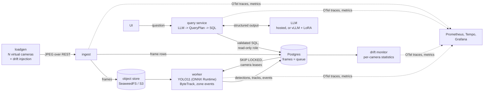

# VMS: a benchmarked video analytics system

A production-style Video Management System that ingests many camera streams, detects and tracks people and vehicles, records zone events, answers natural-language questions about what the cameras saw, and notices when a camera's video drifts. It is built to answer engineering questions with measurements: how many cameras one worker can serve and what limits it, what each precision and serving choice costs in accuracy and buys in latency, how accurate the question answering is (with confidence intervals on a frozen test set), and whether a small fine-tuned LLM can replace a hosted one at a given query volume.

Everything runs on a laptop CPU with `make demo`; GPU and cloud measurements come from short scripted sessions on rented machines with verified teardown (about $6 of compute in total).


<sub>Frames: MOT17 (Milan et al., arXiv:1603.00831, CC BY-NC-SA 3.0) and Wikimedia Commons (Qviri, CC BY-SA 4.0).</sub>

## Headline results

All numbers are self-measured, with 95% bootstrap intervals where they are estimates. Each links to its section in [BENCHMARKS.md](docs/BENCHMARKS.md), which names the hardware, the scenario and the results file.

| | Result | Hardware |
|---|---|---|
| **Question answering** | **95.8% [92.3, 98.6]** execution accuracy on a frozen 142-question test split over a synthetic database; 13/13 red-team questions refused, 0 breaches ([eval](docs/BENCHMARKS.md#baseline-planner-task-35-e-032-e-035-e-036)) | laptop + hosted LLM |
| **Pipeline capacity** | **2 -> 5 cameras** at 5 FPS per worker (freshness p95 under 2 s, 0 frames lost): ONNX Runtime, cross-camera batching and idle threads that sleep; end-to-end gain 1.8x against 1.84x to 2.13x model-only ([ramps](docs/BENCHMARKS.md#optimized-worker-ramp-cpu-task-55-e-047-to-e-049)) | laptop CPU |
| **Cost** | **$0.12 per camera-hour** of compute for the full pipeline on an AWS c7i.2xlarge (3 rated cameras) ([AWS ramp](docs/BENCHMARKS.md#optimized-worker-ramp-on-aws-d35-e-059)) | AWS c7i.2xlarge |
| **Precision ladder** | TensorRT FP16 **2.1x** PyTorch at batch 1 with no mAP change (within 0.1 point); INT8 rejected on CPU and GPU by a rule fixed before the first INT8 run (-1.3 and -2.2 mAP) ([GPU ladder](docs/BENCHMARKS.md#precision-ladder-gpu-task-52-e-064-d38)) | A40 |
| **Drift detection** | Every injected drift caught (36/36), median delay **4.8 s**, **0 false alarms** in 4.2 clean camera-hours, out of sample ([drift](docs/BENCHMARKS.md#detection-delay-and-false-alarms-task-93-e-053-to-e-055-d34)) | laptop CPU |
| **LLM serving** | Prefix caching: time to first token **162 vs 728 ms** and **3.1x** throughput at 16 concurrent on the ~4k-token planner prompt ([vLLM](docs/BENCHMARKS.md#self-hosted-planner-serving-on-one-a40-task-81-e-068-e-069-d40)) | A40 |
| **Fine-tune vs hosted** | LoRA on Qwen3.5-4B (2,660 synthetic pairs): **83.1%** test; 4-bit GPTQ: same accuracy (-0.7 [-3.5, +1.4]), **1.5x** faster; still **12.7 [+7.0, +19.0]** points under the hosted model, which costs **$0.29 per 1,000 questions** and wins below **~1.5M questions/month** ([D7](docs/BENCHMARKS.md#d7-hosted-vs-few-shot-vs-lora-vs-quantized-lora-task-85-e-077-e-078)) | A40 + hosted |

Negative results are reported too: two detector fine-tunes against blur lost more accuracy on clean video than they recovered on blurred video and were not deployed ([fine-tunes](docs/BENCHMARKS.md#detector-fine-tune-against-blur-task-95-e-060-e-061-d36)).

## Architecture



- **Questions never become free-form SQL.** The LLM fills a typed `QueryPlan` (intent, filters, time range, grouping) under constrained decoding; the plan is validated against the catalog, compiled to parameterized SQL, checked by a sqlglot allowlist, and run as a read-only database role with a statement timeout. Unsupported, ambiguous and malicious questions get a typed refusal ([D13, D14](docs/DECISIONS.md)).
- **Postgres is the queue.** Workers lease cameras and claim frames with `SKIP LOCKED`, so one camera's frames are tracked in order; writes are idempotent on `(camera_id, run_id, seq)`. No Kafka or Redis until a benchmark says so ([D3, D18, D20](docs/DECISIONS.md)).
- **Every decision is a record**: 43 decision records with the options, the evidence and what would change them ([DECISIONS.md](docs/DECISIONS.md)), and 78 experiment entries, failures included ([EXPERIMENTS.md](docs/EXPERIMENTS.md)).

Full design: [ARCHITECTURE.md](docs/ARCHITECTURE.md).

## What it looks like

| Asking a question | Pipeline dashboard under load |
|---|---|
|  |  |

| Drift dashboard during an injected drift | Detection delay vs false alarms |
|---|---|
|  |  |

## How the numbers are made

- **Scenarios before runs.** Each benchmark is a YAML scenario in `bench/scenarios/`; the runner excludes warmup, repeats at least 3 times, judges steady state from a Prometheus window, checks that the load generator is not the bottleneck, and writes a results JSON with the git SHA, resolved config, hardware, package versions and seeds ([methodology](docs/BENCHMARKS.md#methodology)).
- **Quality next to speed.** Every precision or serving change reports mAP or execution accuracy with paired bootstrap intervals against its baseline.
- **A frozen test split.** Tuning happens on dev; the test file is hashed and each configuration runs on it once.
- **Rented hardware with verified teardown.** GPU sessions on Runpod and CPU sessions on AWS are scripted end to end: tagged, self-deleting after a time limit, and checked for leftovers after teardown ([RUNBOOK](docs/RUNBOOK.md#gpu-sessions)).

## Quickstart

Requires [uv](https://docs.astral.sh/uv/), GNU make and Docker. No GPU, LLM key or cloud account needed.

```bash
make setup   # Python 3.12 environment from uv.lock, pre-commit hooks, .env
make up      # Postgres, object store, OTel collector, Prometheus, Tempo, Grafana; migrations
make demo    # clips, ingest, worker, query service + UI, 4 virtual cameras, example questions
```

Then open http://localhost:8070 (camera wall and question box) and http://localhost:3000 (Grafana). Without `LLM_MODEL` the planner is a canned stand-in that answers the example questions; point `LLM_BASE_URL` and `LLM_MODEL` at any OpenAI-compatible endpoint (Ollama, vLLM, a hosted API) for open questions. `make check` runs lint, typecheck and the 1,365 unit tests; `make test-integration` runs 64 more against the stack. `make help` lists every target; [RUNBOOK.md](docs/RUNBOOK.md) covers data, benchmarks, evals, GPU sessions and troubleshooting.

## Stack

Python 3.12 (FastAPI, asyncio, pydantic, SQLAlchemy/Alembic, sqlglot), Ultralytics YOLO11, ONNX Runtime, TensorRT, ByteTrack, vLLM, PEFT, Postgres, SeaweedFS, OpenTelemetry, Prometheus, Tempo, Grafana, Docker Compose, DVC, GitHub Actions, TypeScript (Vite) for the UI; AWS (EC2, Budgets) and Runpod for rented compute.

## Limitations

- Question-answering accuracy is measured on 279 questions written for a **synthetic** database; real users' questions would be messier. Intervals at this size are about plus or minus 6 to 9 points.
- Load comes from public video replayed as virtual cameras, and every number is self-measured on one laptop, one AWS instance type or one A40.
- GPU numbers are model-level: the full stack has not run on a GPU host yet, so there is no GPU rated capacity.
- Drift is injected with photometric transforms; the false-alarm rate comes from four clean scenes and is a lower bound for real cameras.

What comes next is in [ROADMAP.md](docs/ROADMAP.md); the full story, including what did not work, is in the [technical write-up](docs/WRITEUP.md).

## Documentation

| Document | Contents |
|---|---|
| [WRITEUP.md](docs/WRITEUP.md) | Technical write-up: problem, design, decisions with evidence, results, failures, limitations |
| [ARCHITECTURE.md](docs/ARCHITECTURE.md) | Current design, component by component |
| [BENCHMARKS.md](docs/BENCHMARKS.md) | Curated numbers, methodology, hardware and how to reproduce each |
| [DECISIONS.md](docs/DECISIONS.md) | Decision records |
| [EXPERIMENTS.md](docs/EXPERIMENTS.md) | Append-only log of every attempt |
| [RUNBOOK.md](docs/RUNBOOK.md) | Setup, data, running, benchmarking, rented sessions, operations, teardown |
| [ROADMAP.md](docs/ROADMAP.md) | What is built and what comes next |

## License

Code: [MIT](LICENSE). The video clips and datasets are not redistributed; each keeps its own license (MOT17 and MOT20 CC BY-NC-SA 3.0, Wikimedia Commons CC BY-SA 4.0, COCO CC BY 4.0, VIRAT by agreement), listed in [RUNBOOK.md](docs/RUNBOOK.md#video-clips-virtual-cameras). Screenshots in `docs/images/` contain MOT17 and Wikimedia Commons frames under those licenses.
