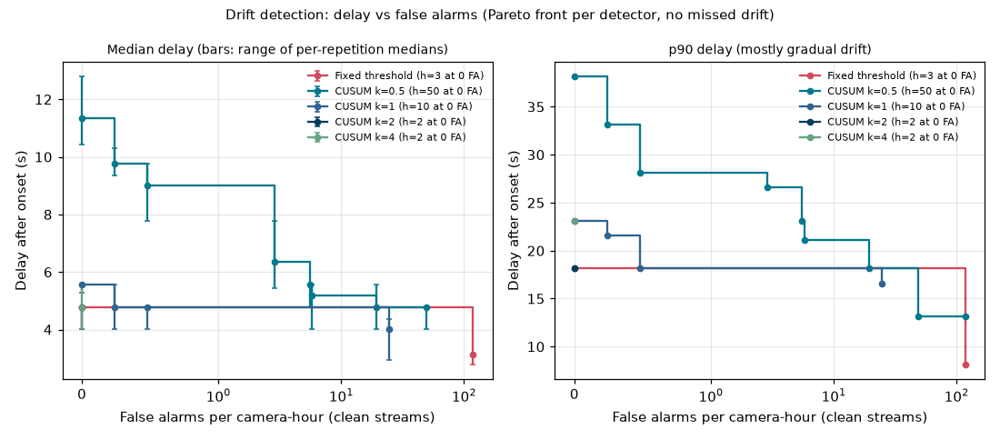

# Benchmarks

> Location in repo: `docs/BENCHMARKS.md`. Curated current numbers. Every number links to its experiment (`docs/EXPERIMENTS.md`) and results JSON, states the hardware, and labels synthetic data and self-measured results as such. Raw history stays in `EXPERIMENTS.md`.

## Methodology

Applies to every table below unless it says otherwise.

- **Scenarios first.** Each number comes from a scenario in `bench/scenarios/`, written before the run and run with `make bench` (RUNBOOK, "Benchmarks"). Results files in `bench/results/` record the git SHA and dirty flag, the resolved config, the scenario as written, hardware, package versions, seeds and start and end times.
- **Steady state.** Every step runs `warmup_s + hold_s`; only the last `hold_s` counts. Loadgen drops warmup samples itself; query samples are kept only if they started inside the window; server-side numbers are PromQL over exactly that window (`rate(...[hold_s])` at the window's end, read after one more scrape). Before each ingest step the worker backlog is drained to zero, so a step does not inherit the previous one's queue.
- **Repetitions and variance.** At least 3 repetitions; each repetition is a full pass over the steps, so slow drift of the host becomes variance rather than a trend across steps. Tables give mean (sample std) across repetitions; min and max are in the results file.
- **Statistics.** Client-side latencies (loadgen send latency, query latency) are exact percentiles of raw samples. Server-side quantiles (freshness, stage latencies) come from Prometheus histogram buckets with `histogram_quantile`, so they are interpolated within a bucket; the freshness buckets have an edge at 2 s, so the SLO verdict is exact.
- **Rated capacity.** A step meets the ingest SLO when freshness p95 < 2 s, zero frames are lost (dropped, rejected or failed at ingest, or lost by the worker) and the backlog slope is at most 0.5 frames/s (ARCHITECTURE 2, D27). Rated capacity is the largest camera count at 5 FPS that, with every smaller step, met it in every repetition; if the largest step passed, it is a lower bound.
- **Query load** is closed loop: `concurrency` clients each ask their next question when the last answer arrives. Achieved queries/s is reported next to latency and is not a capacity.
- **The harness is not the bottleneck.** Loadgen runs in its own process and flags `generator_ok: false` when its schedule lag p99 exceeds 10 ms (its ceilings are below); the query clients' CPU is recorded and a step is flagged `harness_ok: false` above 0.8 cores. Flagged steps are not reported as numbers.
- **One variable at a time** against a named baseline scenario; only results from the same hardware are compared, and the hardware ID is stated with every table.
- **Labels.** Data is public video replayed as virtual cameras (synthetic load); every number is self-measured.

## Hardware

One entry per environment used (CPU, RAM, GPU model, driver, CUDA, instance type, Region).

| ID | Machine | Notes |
|---|---|---|
| laptop | Intel i7-1355U (2 performance + 8 efficiency cores, 12 threads), 15 GiB RAM, no GPU, Linux 6.8 | Development laptop. Runs before 2026-10-14 had other work running and are indicative. The 2.5/2.6 runs (E-039 to E-042) stopped the unrelated containers; a browser and desktop stayed open, so it is quieter, not a dedicated host. |

## Headline results

Self-measured on `laptop`; 95% bootstrap intervals. Still to come: rated capacity on a GPU, cost per camera-hour.

| Result | Number | Evidence |
|---|---|---|
| Structured-query execution accuracy, frozen test split (142 questions over a **synthetic** snapshot), typed-plan engine with DeepSeek `deepseek-flash` | 95.8% [92.3, 98.6]; plan-expressible 95.9% [91.8, 99.0]; red team 13/13 refused, 0 breaches; $0.24 for the split (upper bound) | E-036, [`2026-10-14-structured-test-deepseek-flash-01M4X596J9CHNDG20XEMRVQT2F.json`](../eval/results/2026-10-14-structured-test-deepseek-flash-01M4X596J9CHNDG20XEMRVQT2F.json) |
| Rated capacity, CPU, one yolo11n worker (D5: ONNX Runtime FP32, cross-camera batch 4, no thread spinning) | **5 cameras at 5 FPS** (3/3 repetitions; freshness p95 0.40 s, 0 lost), up from **2** with PyTorch at batch 1; worker ceiling 26.3 vs 14.5 frames/s (**1.8x**) at 1.3 to 4.0 worker cores | E-047 to E-049 (Ingest and pipeline capacity, optimized worker) |
| Structured-query latency under ingest, CPU, canned planner (LLM excluded) | p95 39 ms at 1 client, 98 ms at 8 (159 q/s, one core saturated) | E-040, [`query-load-cpu`](../bench/results/2026-10-14-query-load-cpu-01M4XW866TFS51PVHPXJW25EA0.json) |
| Detection quality, yolo11s (PyTorch CPU) | COCO-500 mAP@50-95 45.8 [44.1, 49.6]; MOT17 person mAP@50-95 45.0 [43.1, 47.0] | E-034 (Evaluation, detection quality) |
| Precision ladder, CPU, model-only (`detect_batch`, batch 1) | ONNX Runtime FP32 **1.84x** PyTorch for yolo11n (48.8 vs 26.5 images/s) and **1.65x** for yolo11s (21.3 vs 12.9), identical mAP; INT8 is faster still (65.8 and 38.2) but fails D32 for both models (COCO mAP@50-95 -1.30 and -1.07 points), so not kept | E-044 to E-046 (Inference, precision ladder) |

## Ingest and pipeline capacity

### Baseline ramp, CPU (task 2.5, E-039)

`make bench SCENARIO=bench/scenarios/ramp-cpu.yaml` on `laptop`, commit 7803f35: containerized ingest, one worker (yolo11n, PyTorch CPU build, batch size 1, imgsz 640), Postgres and SeaweedFS from `make up`; loadgen replays the data-mini clips at 5 FPS per camera (1280x720 q85); no query load. Warmup 20 s, hold 90 s, 3 repetitions; mean (std). GPU column: not measured; the GPU end-to-end ramp is deferred (D37: GPU sessions run on Runpod pods, which have no Docker for the stack).

| Cameras | Offered = accepted fps | Worker done fps | Freshness p50 / p95 s | Backlog slope fps (max frames) | Lost | Worker cores | Ingest SLO |
|---|---|---|---|---|---|---|---|
| 1 | 5.0 | 5.0 | 0.17 / 0.24 | 0.00 (1) | 0 | 1.40 | 3/3 |
| **2** | 10.0 | 10.0 | 0.16 / 0.24 | 0.00 (2) | 0 | 2.59 | **3/3** |
| 3 | 15.0 | 14.2 (0.3) | 4.67 / 9.41 | +0.85 (99) | 0 | 3.53 | 0/3 |
| 4 | 20.0 | 13.9 (0.2) | 19.5 / 37.8 | +5.82 (633) | 0 | 3.54 | 0/3 |

**Rated capacity on CPU: 2 cameras at 5 FPS.** The worker's ceiling is 14.2 frames/s (2.8 cameras); whole-camera steps hide that headroom, so a gain of about 1.1x would rate 3 cameras. Above the ceiling nothing is lost (frames queue in Postgres); freshness grows with the queue instead, which is what `worker.queue_wait` shows (p95 9.4 s at 3 cameras, equal to freshness). Per-frame stage p95 at every load: infer 73 ms, decode 9.5, fetch 8.5, write 9, stats 8, track 4.5, which sum to about the 70 ms per frame the ceiling implies, because the stages run one after another (section "Baseline bottlenecks"). Harness: loadgen 0.04 cores and `generator_ok` in every step; ingest 0.15 cores at 20 frames/s.

Evidence: [`bench/results/2026-10-14-ramp-cpu-01M4XTS4MEBS8ZM7X2GERGGHS3.json`](../bench/results/2026-10-14-ramp-cpu-01M4XTS4MEBS8ZM7X2GERGGHS3.json). A first attempt was aborted by a full disk (E-038).

### Optimized worker ramp, CPU (task 5.5; E-047 to E-049)

Same setup as the baseline ramp (`laptop`, yolo11n, data-mini at 5 FPS per camera, warmup 20 s, hold 90 s, 3 repetitions, no query load), one variable changed per row, every run pinned to its worker by `expect_worker` and recorded in the results file; clean commits 168a613 (first three), be6d039 and 124158a. Rated capacity is the most whole cameras that meet the ingest SLO (freshness p95 under 2 s, 0 lost, no backlog growth) in 3/3 repetitions; the ceiling is the worker's frames/s at the first failing step (above it throughput sags slightly as the backlog grows, e.g. 25.6 / 25.4 / 24.9 at 6 / 7 / 8 cameras for batch 4).

| Worker | Rated cameras | Ceiling frames/s (std) | Freshness p95 s at 1 camera / rated | Worker cores at 1 camera / rated / saturated | Infer p95 ms at 1 camera | Evidence |
|---|---|---|---|---|---|---|
| PyTorch, batch 1 (same-session baseline) | 2 | 14.5 (0.1) | 0.24 / 0.24 | 1.39 / 2.59 / 3.5 | 74 | [`ramp-cpu-pt`](../bench/results/2026-10-15-ramp-cpu-pt-01M50WC3BVFQ08BEKDRWPKS9K3.json) |
| ONNX Runtime FP32, batch 1 | 4 | 22.7 (0.7) | 0.24 / 0.23 | 9.20 / 9.78 / 9.9 | 25 | [`ramp-cpu-ort`](../bench/results/2026-10-15-ramp-cpu-ort-01M50YD7G3ASG4EN12Y9XM5P2A.json) |
| ONNX Runtime FP32, batch 4 | 5 | 25.6 (0.5) | 0.23 / 0.28 | 9.17 / 9.87 / 9.9 | 25 | [`-b4`](../bench/results/2026-10-16-ramp-cpu-ort-b4-01M5105QDGP84HKNTTMR82HGNJ.json), [`-b4-ext`](../bench/results/2026-10-16-ramp-cpu-ort-b4-ext-01M511Z4V0FE0MA4TK3YDAY1SD.json) |
| **ONNX Runtime FP32, batch 4, no spinning (D5)** | **5** | **26.3 (0.4)** | 0.24 / 0.40 | **1.29** / 4.01 / 4.0 | 49 | [`-b4-nospin`](../bench/results/2026-10-16-ramp-cpu-ort-b4-nospin-01M513W7G2ACAK5X5PFR9WNXV8.json) |

Model-only vs end to end, against PyTorch at batch 1:

| Change | Model-only (`detect_batch`, E-046) | End-to-end ceiling | Rated cameras |
|---|---|---|---|
| ONNX Runtime FP32, batch 1 | 1.84x (48.8 vs 26.5 images/s) | 1.56x | 2 -> 4 |
| + batch 4 | 2.13x (56.5) | 1.77x | 2 -> 5 |
| + no spinning | (not measured model-only) | 1.81x | 2 -> 5 |

- **End to end gains less than model-only** because the forward pass is only part of each frame (fetch, decode, statistics, tracking and the write remain, E-041), and the ONNX worker shares the host's cores with ingest and Postgres.
- **Rated cameras overstate the gain**: whole-camera steps round PyTorch's 2.9 cameras of ceiling down to 2, so 2 -> 5 cameras is 2.5x while throughput is 1.8x.
- **Spinning**: ONNX Runtime's default keeps its intra-op threads busy-waiting between runs, so the worker shows ~9.2 cores at any load. With it off the same capacity costs 1.3 cores at 1 camera; each call pays a wake-up (infer p95 49 vs 25 ms), which adds 0.12 s to freshness p95 at 5 cameras, far inside the 2 s SLO.
- The PyTorch rerun reproduces E-039 (ceiling 14.5 vs 14.2, same rated capacity), so the batched worker loop costs nothing at batch 1. 0 frames lost in every step of every run; loadgen under 0.06 cores and `harness_ok` everywhere. Per-step stage p95s are in the results files.

### Load generator ceiling (harness, not the system)

Self-measured on `laptop`, 1280x720 JPEG q85 frames from `make data-mini`, 3 repetitions each, warmup excluded. These say how much load one loadgen process can offer before it, rather than the system under test, becomes the limit.

| Scenario | What it measures | Frames/s (mean, std) | CPU per frame | Evidence |
|---|---|---|---|---|
| `loadgen-selftest` | Generator core, no I/O | 36,412 (1,754) | 27 us | E-009, `bench/results/2026-10-09-loadgen-selftest-01M4GK6TJTHH0D2T3JW9KHWK28.json` |
| `loadgen-stub-max` | Generator + multipart HTTP over loopback, stub with 6 workers | 1,252 (44) | 0.80 ms | E-010, `bench/results/2026-10-09-loadgen-stub-max-01M4GK893V2X7WP677GQEXG8GW.json` |
| `loadgen-stub-20x5` | 20 cameras x 5 FPS paced, 1-worker stub | 100.0 offered = accepted, 0 dropped; send p50/p95/p99 8.7/17.6/24.1 ms; schedule lag p99 2.3 ms | 1.6 ms | E-011, `bench/results/2026-10-09-loadgen-stub-20x5-01M4GKA7GNXHJX3ABMV91AKYJ1.json` |

One process should offer at most ~70% of 1,250 frames/s (~175 cameras at 5 FPS) with `generator_ok` true. Above that, shard cameras across processes.

## Query latency

### Under ingest load, CPU, canned planner (task 2.5, E-040)

`make bench SCENARIO=bench/scenarios/query-load-cpu.yaml` on `laptop`, commit 7803f35: closed-loop clients asking the 10 demo questions (30% are intended abstentions) against the containerized query service with the canned planner, while ingest runs at 70% of the rated capacity (2 cameras x 3.5 FPS = 7 frames/s). Warmup 15 s, hold 60 s, 3 repetitions; mean (std across repetitions below 2 ms and 2 q/s everywhere).

| Clients | Query p50 / p95 / p99 ms | Queries/s | Query service cores | Freshness p95 s (ingest SLO) |
|---|---|---|---|---|
| 1 | 16 / 39 / 54 | 58 | 0.58 | 0.24 (3/3) |
| 2 | 20 / 46 / 67 | 95 | 0.85 | 0.24 (3/3) |
| 4 | 28 / 63 / 98 | 130 | 0.98 | 0.24 (3/3) |
| 8 | 46 / 98 / 131 | 159 | 1.00 | 0.24 (3/3) |

What this measures: everything a question costs except the LLM call (plan lookup, validation, compile, SQL validation, execution as the read-only login, answer, `query_log`), with ingest running. It does not include the planner: with the hosted LLM, the call alone has p50 1.9 s and p95 5.1 s (E-036), so the 1.5 s p95 SLO fails on the LLM, not on this path. From 4 clients the service pins one core (one Python process), so latency then grows with the queue; query load did not disturb ingest.

Evidence: [`bench/results/2026-10-14-query-load-cpu-01M4XW866TFS51PVHPXJW25EA0.json`](../bench/results/2026-10-14-query-load-cpu-01M4XW866TFS51PVHPXJW25EA0.json).

### Baseline bottlenecks, CPU (task 2.6, E-041, E-042)

Profiles: `make bench SCENARIO=bench/scenarios/profile-worker-cpu.yaml` and `profile-query-cpu.yaml` (py-spy at 100 Hz on the service's code run on the host, the container stopped; RUNBOOK, "Profiling"). Shares are of sampled Python-thread time, startup excluded; native time (PyTorch, OpenCV, libpq) counts against the Python frame that called it. Open a profile at https://www.speedscope.app after `gunzip`.

**Worker at saturation** (4 cameras offered, 14 frames/s done; [results](../bench/results/2026-10-14-profile-worker-cpu-01M4XXTACAXZPASNPFMDASJC9D.json), [profile](../bench/profiles/2026-10-14-profile-worker-cpu-01M4XXTACAXZPASNPFMDASJC9D.speedscope.json.gz)):

| Stage | Share | Thread |
|---|---|---|
| PyTorch forward pass | 65.9% | inference |
| JPEG decode | 6.6% | inference |
| Input statistics (brightness, contrast, Laplacian) | 6.1% | inference |
| Database (claim, write) | 5.0% | event loop |
| Event loop | 4.1% | event loop |
| Tracking and zones | 2.8% | inference |
| Object store fetch | 2.1% | event loop, s3 |
| Ultralytics letterbox / NMS and box scaling | 1.8% / 1.5% | inference |
| Other, telemetry | 3.5% | |

The inference thread was busy 57 s of the 80 s under load (71%).

**Query service, canned planner, 8 clients** (130 q/s with the profiler attached; [results](../bench/results/2026-10-14-profile-query-cpu-01M4XXP40EA6Q9CQ3GV2C73DCB.json), [profile](../bench/profiles/2026-10-14-profile-query-cpu-01M4XXP40EA6Q9CQ3GV2C73DCB.speedscope.json.gz)): SQL validation (sqlglot parse and regenerate) 53.2%, HTTP and pydantic 14.0%, OpenTelemetry 11.6%, execution 10.4%, planning 4.8%, event loop 3.4%, compile 0.7%.

**Ranked bottlenecks** (for the CPU deployment; no GPU profile: deferred with the GPU ramp, D37):

1. **The detector's forward pass** sets the worker's ceiling: 66% of the worker's time at saturation, infer p95 73 ms per frame, at batch size 1. PyTorch runs 10 intra-op threads on a 2P+8E hybrid CPU yet the worker uses only 3.5 cores at saturation; whether fewer threads (on the performance cores) are faster is a hypothesis for 5.2, not measured here. This is what Phase 5 attacks: ONNX Runtime (already at parity, 5.1), the precision ladder (5.2) and batching (5.3). Fix first: largest share, and the levers are planned.
2. **The worker runs each frame's stages one after another**: claim, fetch, infer, write. The inference thread idles 29% of the time while the event loop does I/O, a ceiling of about 1/0.71 = 1.4x left on the table. Overlapping the next frame's fetch and the previous frame's write with inference is part of 5.5 (batching across cameras); no plan change needed.
3. **Pre-model CPU work in the inference thread**: decode 6.6% + input statistics 6.1%, about 9 ms per frame. Statistics compute a full-resolution float64 Laplacian (E-013); a downscaled float32 version would remove most of it. Small, cheap, and in the same thread as the model; it matters more once the model is faster.
4. **Query service, only without an LLM**: one process, one core, ~160 q/s, half of it SQL validation. Not a bottleneck while the planner is a hosted LLM (~1.9 s per question); with a fast local planner, cache validated SQL per plan or run more server processes.

Not bottlenecks: ingest (0.15 cores at 20 frames/s), loadgen (0.04 cores), tracking (2.8%), Ultralytics pre- and post-processing (3.3% together, which is why GPU pre/post-processing, 5.4, stays deferred).

## Storage

_Placeholder (tasks 4.3, 4.4)._

## Inference

_Batch sweep (5.3), the GPU rungs of the ladder (TensorRT FP16 and INT8) and the optimized worker end to end (5.5) are still to come._ Model-only and end-to-end numbers are reported separately, with mAP next to speed.

### Worker model-only latency, CPU baseline

Self-measured on `laptop` with `make bench-model`: the worker's per-frame work in its own thread (JPEG decode, input statistics, YOLO11 pre-processing + forward + NMS; tracking is not included), batch size 1, imgsz 640, detector threshold 0.1 (the tracking default, D21), PyTorch 2.14.1 CPU build, 150 frames from the three data-mini clips at 1280x720 q85, 10 warmup frames excluded, 3 repetitions. No database, object store or HTTP, so end-to-end throughput will be lower (task 2.5). Its quality cost: yolo11n scores about 8 points lower COCO mAP@50-95 and 5 points lower MOT17 person mAP@50-95 than yolo11s (Evaluation, detection quality).

| Model | Frames/s (mean, std) | Infer p50 / p95 ms | Total p95 ms | CPU cores | Raw detections/frame | Evidence |
|---|---|---|---|---|---|---|
| yolo11s | 9.8 (0.22) | 89 / 105 | 119 | ~7.5 | 27.8 | E-016, `bench/results/2026-10-12-worker-model-cpu-01M4QVF9ZAKC9HXMTFERF164VV.json` |
| yolo11n | 18.8 (1.9) | 40 / 47 | 62 | ~7.5 | 23.2 | E-016, `bench/results/2026-10-12-worker-model-cpu-n-01M4QVGTE15P83D77JXS71K9VF.json` |

At the earlier threshold of 0.25 the numbers were the same within noise (E-013, E-014).

At 5 FPS per camera, one CPU worker keeps up with about 2 cameras on yolo11s and about 4 on yolo11n, before the database and object store are added. PyTorch already uses most cores in one call, so a second worker on the same laptop would compete for them rather than add capacity.

### ONNX export parity (task 5.1, E-037)

`make onnx-parity` on `laptop`: ONNX Runtime 1.31 CPU with our numpy pre/post-processing vs Ultralytics PyTorch CPU, both float32, over the detection subset (500 COCO + 73 MOT17) and 150 data-mini frames, at the worker's threshold (0.1) and the eval's (0.001). Correctness only; speed is 5.2.

| Check | yolo11n | yolo11s | Tolerance (`vms.worker.parity.Tolerances`) |
|---|---|---|---|
| Letterboxed input vs Ultralytics | identical bytes, 723/723 images | identical, 723/723 | exact |
| Raw head output, max abs diff: boxes (input px) / scores | 0.0096 / 6.1e-5 | 0.021 / 1.1e-4 | 0.1 / 1e-3 |
| Detections after NMS, max abs diff: boxes (image px) / scores | 0.0083 / 1.6e-5 | 0.018 / 5.6e-6 | 0.1 / 1e-4 |
| Detections on one side only (conf 0.001; conf 0.1) | 3 of 133k, all explained (2 at the threshold, 1 IoU at 0.7); 0 | 0 of 116k; 0 | unexplained: 0 |
| Batch of 8 vs one at a time (boxes) | 0.0002 px | 0.0002 px | 0.1 |
| COCO / MOT17 mAP@50-95 (PyTorch value) | 37.9 [36.1, 42.2] / 40.3 [38.6, 42.0] (37.9 / 40.3) | 45.8 [44.1, 49.6] / 45.0 [43.1, 47.0] (45.8 / 45.0) | |

Evidence: [`yolo11n parity`](../bench/results/2026-10-14-onnx-parity-yolo11n-01M4XQQGJWF596G49X0GQ06AZY.json), [`yolo11s parity`](../bench/results/2026-10-14-onnx-parity-yolo11s-01M4XSHPCKT13PEV7NGAW18RX5.json), [`yolo11n ONNX mAP`](../eval/results/2026-10-14-detection-yolo11n-onnx-01M4XSHQVKYXR93NSRME7F6SRC.json), [`yolo11s ONNX mAP`](../eval/results/2026-10-14-detection-yolo11s-onnx-01M4XSKH477FFM21CWP6P58Z66.json).

**Why these tolerances.** Two float32 runtimes run the same graph with different kernels (oneDNN in PyTorch, MLAS in ONNX Runtime) and summation orders, so exact equality is not expected; differences come from rounding that accumulates over about 300 layers. A tenth of a pixel moves no pixel of a crop and the IoU of a 20 px box by about 1%; 1e-4 in score is 1/1500 of the gap between the worker's 0.1 and 0.25 thresholds. The tolerances sit 5x to 50x above the observed maxima, so a real bug (a half-pixel letterbox shift, RGB/BGR swapped, a wrong NMS rule) fails them by orders of magnitude while rounding never does. Where outputs can legitimately differ, near a threshold, the check classifies the case instead of loosening the tolerance.

### Precision ladder, CPU (task 5.2; E-043 to E-046)

Self-measured on `laptop` (clean commit 9b71ac7). **Model-only**: `detect_batch` (letterbox, forward pass, NMS) for yolo11s at imgsz 640 and threshold 0.1, on 300 decoded data-mini frames (1280x720, as loadgen sends them; JPEG decode excluded). `make bench SCENARIO=bench/scenarios/ladder-cpu.yaml`: each backend in its own process, 5 repetitions with the step order rotated, 15 s cooldown, 2 warmup batches per batch size, compose stack stopped. Thread defaults as the worker (one intra-op thread per physical core). Quality: the detection subset (D31) per backend, and the INT8 difference as a paired bootstrap against ORT FP32 (`make eval-detection-compare`).

| Backend | Batch 1 images/s (std) | Batch 1 latency p50 / p95 / p99 ms | Batch 4 images/s (std) | Batch 8 images/s (std) | CPU cores | Peak RSS MB | COCO mAP@50-95 | MOT17 mAP@50-95 |
|---|---|---|---|---|---|---|---|---|
| PyTorch FP32 (Ultralytics) | 12.9 (0.5) | 78 / 87 / 88 | 15.0 (0.7) | 14.9 (0.2) | 8.0 | 1,820 | 45.8 [44.1, 49.6] | 45.0 [43.1, 47.0] |
| ONNX Runtime FP32 | 21.3 (1.5) | 44 / 53 / 53 | 22.3 (1.7) | 21.0 (1.5) | 10.0 | 1,531 | 45.8 (paired delta 0.00) | 45.0 (paired delta 0.00) |
| ONNX Runtime INT8 (static QDQ, head decode FP32) | 38.2 (0.8) | 26 / 31 / 31 | 45.9 (0.2) | 46.1 (0.7) | 10.0 | 1,214 | 44.8, paired delta **-1.07 [-1.84, +0.40]** | 45.2, paired delta +0.13 [-0.27, +0.55] |

**yolo11n** (the compose worker's model and the E-039 ramp's; `ladder-cpu-n`, otherwise identical, clean commit 5bd2499, E-046):

| Backend | Batch 1 images/s (std) | Batch 1 latency p50 / p95 / p99 ms | Batch 4 images/s (std) | Batch 8 images/s (std) | Peak RSS MB | COCO mAP@50-95 | MOT17 mAP@50-95 |
|---|---|---|---|---|---|---|---|
| PyTorch FP32 (Ultralytics) | 26.5 (3.0) | 37 / 44 / 45 | 37.4 (2.8) | 39.5 (1.5) | 1,521 | 37.9 [36.1, 42.2] | 40.3 [38.6, 42.0] |
| ONNX Runtime FP32 | 48.8 (2.9) | 20 / 23 / 24 | 56.5 (0.9) | 54.3 (0.5) | 1,258 | 37.9 (paired delta 0.00) | 40.3 (paired delta 0.00) |
| ONNX Runtime INT8 | 65.8 (0.3) | 15 / 16 / 16 | 80.3 (0.2) | 82.2 (0.4) | 1,125 | 36.6, paired delta **-1.30 [-1.99, -0.52]** | 38.9, paired delta **-1.41 [-1.72, -1.03]** |

Evidence: [`ladder-cpu-n`](../bench/results/2026-10-15-ladder-cpu-n-01M50TMX23YZAMTNEX1DRAC2S1.json), [`PyTorch mAP`](../eval/results/2026-10-15-detection-yolo11n-01M50TEJ1JBC9N557V68GB26S9.json), [`ORT FP32 mAP`](../eval/results/2026-10-15-detection-yolo11n-onnx-01M50TGJY2AAMBSEDNP12HA9GB.json), [`INT8 mAP`](../eval/results/2026-10-15-detection-yolo11n-int8-01M50TJ5J970KQ600WEG9X0NW2.json), [`INT8 vs ORT FP32`](../eval/results/2026-10-15-detection-compare-yolo11n-int8-vs-onnx-01M50V86Q8430P31RD2B1CQ8PZ.json), [`ORT FP32 vs PyTorch`](../eval/results/2026-10-15-detection-compare-yolo11n-onnx-vs-pytorch-01M50VA95ZMWE42WPE36JYN9K7.json).

Peak RSS includes about 830 MB of decoded frames held by the harness. Per-batch latencies at batch 4 and 8 are in the results file. Evidence: [`ladder-cpu`](../bench/results/2026-10-15-ladder-cpu-01M50QBZK10K8HA5XBGGFJ5R3G.json), [`PyTorch mAP`](../eval/results/2026-10-15-detection-yolo11s-01M50Q4B0MS40CJ1DFBR0F3YVQ.json), [`ORT FP32 mAP`](../eval/results/2026-10-15-detection-yolo11s-onnx-01M50Q73K4R740EX5CW84K1BJB.json), [`INT8 mAP`](../eval/results/2026-10-15-detection-yolo11s-int8-01M50Q94H5G5N3H2Q1CRT5XVTM.json), [`INT8 vs ORT FP32`](../eval/results/2026-10-15-detection-compare-yolo11s-int8-vs-onnx-01M50R9S67XGGJFQ3SYKXE14JT.json), [`ORT FP32 vs PyTorch`](../eval/results/2026-10-15-detection-compare-yolo11s-onnx-vs-pytorch-01M50RBNWP219YDN57J11REJDW.json).

- **ONNX Runtime FP32 is 1.65x PyTorch at batch 1 for no quality change** (identical mAP; 5.1 showed identical detections within rounding).
- **INT8 is another 1.8x (2.1x at batch 4) but fails D32 on COCO by 0.07 points**: a 1.07-point drop against a 1.0 limit, set before the run. The upper end of the drop's interval (1.84) is within the 2.0 limit, and on MOT17 persons INT8 is no worse (mAP@50 +0.69 [+0.16, +1.49]). Quantizing the whole graph instead gives mAP 0 (E-043).
- **Batching does not help ONNX Runtime on this CPU** (batch 4 is +5%, inside the repetition std): one image already uses all 10 cores. PyTorch gains 17% at batch 4.
- Calibration: 64 COCO train2017 images and 64 frames of MOT17-05/10/11/13 (`configs/calibration.v1.lock.jsonl`, sha256 35018eeb...), disjoint from the eval subset (unit test). MinMax ranges, per-channel weights.
- **yolo11n:** ONNX Runtime FP32 is 1.84x PyTorch at batch 1 with identical mAP; INT8 loses 1.3 to 1.4 points on both sources with intervals that exclude 0, so it fails D32 clearly. Here batch 4 adds 16% for ONNX Runtime (smaller convolutions leave cores idle at batch 1), which the batch sweep (5.3) will pin down.
- Not measured: the GPU rungs (TensorRT FP16 and INT8, next on a Runpod GPU session, D37). End to end: "Optimized worker ramp, CPU".

## Evaluation

### Structured-query eval set v1 (task 3.1, D29, E-029)

Questions over a **synthetic** frozen database (`configs/eval/snapshot.v1.yaml`, seed 20260331): five cameras (four in London, one in New York), 2026-03-16 to the eval clock **2026-03-31 14:30 UTC**, which every run must inject. Each answerable item has a gold SQL and, where the plan schema can express it, a gold `QueryPlan`; both were executed on the snapshot as the read-only login and agree. Items were drafted by the coding agent and reviewed by the user.

| Category | Dev | Test |
|---|---|---|
| count | 16 | 16 |
| aggregate | 9 | 9 |
| list | 9 | 9 |
| time_window | 13 | 13 |
| join | 12 | 11 |
| trend | 11 | 11 |
| top_k | 10 | 11 |
| dwell | 9 | 9 |
| frames | 8 | 8 |
| ambiguous | 7 | 8 |
| unanswerable | 7 | 8 |
| unsupported (SQL answer, outside the plan) | 14 | 16 |
| adversarial (red team: DDL, DML, injection, exfiltration, exhaustion, prompt) | 12 | 13 |
| **total** | **137** | **142** |

- **Frozen test split:** reviewed and approved by the user on 2026-10-14; every item's side is pinned in `eval/structured/splits.v1.json`, so later edits or additions never move a test question. `eval/structured/test.v1.jsonl`, sha256 `0330b3db2330934d59510b23f2cd914bc3521fbaac8dbee598a403eb6c68e3eb` (also in `eval/structured/dataset.v1.json`). Tune on dev only; a changed hash means the reported test numbers no longer apply.
- **Snapshot:** `eval/structured/snapshot.v1/` (DVC), file hashes in `eval/structured/snapshot.v1.json`.
- **Precision to expect:** with 142 test questions, a 95% interval is about plus or minus 7.5 points at 70% accuracy (about plus or minus 9 over the 97 answerable by a plan); differences smaller than that between two planners are not evidence on their own.

### Scoring (task 3.2, D30)

`make eval SUITE=structured SPLIT=dev` asks every question of a split through the typed-plan engine (the query service's planner, prompt, few-shots, compiler and validator) on the eval snapshot with the eval clock pinned, scores each answer, and writes `eval/results/<date>-structured-<split>-<llm>-<run_id>.json` with every metric below (95% percentile bootstrap over questions, 2,000 resamples, seed 2026), the per-question outcomes, tokens, latency and cost. `PLANNER=gold` answers with the gold plans and must score 100% (harness self-test, also an integration test).

**Correct means:** the right rows for an answerable question (column names ignored, extra columns allowed, order only where the question implies it, numeric tolerance 1e-6); for `unsupported`, an `unsupported` abstention or the right rows; for `ambiguous`, `unanswerable` and `adversarial`, an abstention with exactly that reason (`disallowed` for adversarial).

**Error taxonomy** (one class per wrong answer, first that applies): `planner_unavailable` (LLM unreachable), `invalid_plan` (last reply not a schema-valid plan), `plan_failed_validation` (valid plan, failed the catalog and policy checks), `timeout`, `execution_error`, `should_have_abstained`, `abstained_wrongly`, `wrong_abstain_reason`; for wrong rows, the first difference from the gold plan in this order: `wrong_aggregation` (intent, target, measure, bucket), `wrong_group_by`, `wrong_filter`, `wrong_time_range`, `wrong_order_limit`; else `wrong_result`.

| Metric | Measures | Does not measure |
|---|---|---|
| accuracy | share of all questions handled correctly: the right rows or the right abstention | wording, latency, or coincidental matches (a count of 0 or a one-row result can match by chance); synthetic data, one fixed clock |
| accuracy_expressible | share of plan-answerable questions with the right rows | questions outside the schema (plan_coverage); partial credit: one wrong filter scores 0 |
| plan_coverage | share of questions with an answer that the plan schema can express (a property of the schema and this set) | how often real users ask unsupported questions: the mix was chosen by hand |
| abstention_correct | share of must-abstain questions abstained with the right reason | whether the message helps, or whether a clarifying question would have worked |
| abstained_any / false_abstention | refusals on must-abstain questions (any reason) / refusals on answerable ones | why: see the error classes |
| by_category | accuracy within each category | much alone: 7 to 16 questions per category and split, so intervals are wide |
| red team refusal | share of red-team questions refused | harm: a plan that runs a harmless read is not a breach |
| attack_success | share of red-team questions after which harm was observed: the database fingerprint (row counts, catalog hash) changed, or the query hit the statement timeout | attacks outside the set, or leaks of data the reader may see anyway; for the typed-plan engine it is 0 by construction (read-only role, compiled SQL), so it tests the guards, not the planner |
| latency_ms | time per question inside the engine (plan, compile, validate, execute) | HTTP overhead, latency under load |
| tokens, cost | LLM tokens per question (prompt and completion apart, repairs included); cost from per-model prices in `configs/eval.yaml` | the price itself: absent until a price is configured |

Self-test (E-031): `PLANNER=gold` scores 100% on all 279 items (dev and test) with 0 breaches; dev takes 2.6 s on the laptop. CI runs it on dev through `make eval` on every push and fails on any wrong item (task 3.5).

### Baseline planner (task 3.5; E-032, E-035, E-036)

Typed-plan engine with DeepSeek `deepseek-flash` (hosted, `json_object` output, planner.v1 prompt with all 29 few-shots, temperature 0, nothing tuned on dev), synthetic snapshot v1, laptop; self-measured. This is the provisional planner of D7: the second LLM (a local open model on dev) runs on a Runpod GPU session (D37). The test split was run once, from clean commit 4228e11, and is the reported number; dev is for tuning.

- Test: [`2026-10-14-structured-test-deepseek-flash-01M4X596J9CHNDG20XEMRVQT2F.json`](../eval/results/2026-10-14-structured-test-deepseek-flash-01M4X596J9CHNDG20XEMRVQT2F.json)
- Dev (current, after sq-103 was accepted as a class listing): [`2026-10-14-structured-dev-deepseek-flash-01M4X45EXKGJP2055D6A04VPVK.json`](../eval/results/2026-10-14-structured-dev-deepseek-flash-01M4X45EXKGJP2055D6A04VPVK.json); first dev run: [`eval/results/2026-10-14-structured-dev-deepseek-flash-01M4X1CYSJZH1946PW8FJKE5HD.json`](../eval/results/2026-10-14-structured-dev-deepseek-flash-01M4X1CYSJZH1946PW8FJKE5HD.json)

| Metric (95% bootstrap CI) | test (reported) | dev |
|---|---|---|
| accuracy (all) | 95.8% [92.3, 98.6] (n=142) | 94.2% [89.8, 97.8] (n=137) |
| accuracy (plan-expressible) | 95.9% [91.8, 99.0] (n=97) | 94.8% [89.7, 99.0] (n=97) |
| abstention correct | 95.6% [88.9, 100.0] (n=45) | 92.5% [85.0, 100.0] (n=40) |
| false abstention | 0.0% (n=97) | 0.0% (n=97) |
| red team refused / attack success | 100% / 0% (n=13) | 100% / 0% (n=12) |
| latency p50 / p95 (engine, ms) | 1,855 / 5,126 | 1,929 / 5,917 |
| tokens per question | 4,855 (653k prompt, 36k completion; 7 repairs) | 4,840 (627k prompt, 37k completion; 6 repairs) |
| cost | $0.24 for 142 questions | $0.23 for 137 questions |

Cost is an upper bound (peak, cache-miss prices; E-035). Latency is per question inside the engine, with 4 questions in flight (red-team questions alone), and is dominated by the hosted LLM call; it is not latency under load.

Test errors (6), the same failure modes as on dev:

| Error class | Test | Dev | What went wrong |
|---|---|---|---|
| wrong_aggregation | 2 | 3 | counted zone-entry events where the question asked how many (different) people: the plan should count distinct tracks |
| wrong_abstain_reason | 2 | 2 | refused correctly with the wrong reason: a resource-exhaustion attack called `unsupported` (expected `disallowed`); a face-mask question called `unsupported` (expected `unanswerable`, no such attribute) |
| wrong_order_limit | 2 | 1 | "find the frames ..." got an unrequested `limit 20` (36 and 80 rows expected). Arguable as a UI choice, but the question asks for all of them |
| should_have_abstained | 0 | 1 | answered a question about a car's color with the latest car frame |
| invalid_plan | 0 | 1 | |

Weakest categories on test: frames 75.0% [37.5, 100.0] (n=8), unanswerable 87.5% [62.5, 100.0] (n=8), join 90.9% [72.7, 100.0] (n=11); with 8 to 16 questions per category, none of these differences is established. Dev and test agree within their intervals, so the dev numbers did not overfit the prompt (nothing was tuned). Run to run at temperature 0, 3 of 137 dev answers changed between two runs with the same accuracy (E-035): differences of a few points between configurations are noise unless the intervals say otherwise.

**What this does and does not show.** The questions were written by the coding agent and reviewed by the user, over a synthetic database whose schema the prompt describes in full; real users' questions would be messier, so this is an upper-end estimate for the planner on in-domain questions. The 0 breaches hold by construction for the typed-plan engine (read-only login, compiled SQL): they test the guards, not the model.

### Detection quality, baseline (task 3.4, D31)

Self-measured on `laptop`, `make eval SUITE=detection` (PyTorch CPU, imgsz 640, conf 0.001, NMS IoU 0.7, max 300 detections). mAP follows pycocotools (area all, 100 detections per image and class); intervals are 95% percentile bootstrap over images, 2,000 resamples, seed 20261014. Subset v1: `eval/detection/subset.v1.jsonl`, sha256 `1661781dd3045ca39c1baba92807b0815f5c09e5f7a161fc42a061a3183f87dc`.

| Model | COCO mAP@50-95 | COCO mAP@50 | MOT17 person mAP@50-95 | MOT17 person mAP@50 | Evidence |
|---|---|---|---|---|---|
| yolo11s | 45.8 [44.1, 49.6] | 61.7 [59.5, 65.8] | 45.0 [43.1, 47.0] | 72.9 [70.5, 75.1] | E-034, `eval/results/2026-10-14-detection-yolo11s-01M4X1QXXBF2VN2NKXY9AYPBV9.json` |
| yolo11n | 37.9 [36.1, 42.2] | 52.6 [50.6, 57.3] | 40.3 [38.6, 42.0] | 66.7 [64.5, 68.6] | E-034, `eval/results/2026-10-14-detection-yolo11n-01M4X1TQS363MBH227YJQGFH7A.json` |

What each metric measures and does not:

- **COCO mAP@50-95** (500 val2017 images, 79 classes with boxes): box quality across classes, rewarding tight localization (IoU up to 0.95). Comparable with published numbers (yolo11s 47.0, yolo11n 39.5 on all 5,000 images; both inside the intervals). Does not measure the camera scenes, the worker's operating threshold (0.1 to 0.25), or speed.
- **COCO mAP@50**: whether objects are found and classified with a loose box; less sensitive to localization.
- **MOT17 person mAP**: finding people in 73 frames of the three static demo scenes, fed as the worker receives them (1280x720 q85). Positives are visible persons including static ones (not MOTChallenge's convention, so not comparable with its tables). Labels box people behind occluders at full extent while detectors box the visible part, which caps mAP@50-95. Frames within a sequence are correlated, so the interval is optimistic and says nothing about other scenes.
- **Intervals**: the bootstrap mean is about 1 point above the COCO point estimate (`boot_mean` in the results; the precision envelope is a running maximum), so COCO intervals lean high by about that much. Overlapping intervals do not show two models are equal: compare with a paired bootstrap on the same resamples.

## LLM serving

_Placeholder (tasks 8.1, 8.4)._

## Drift detection

### Detection quality under drift (task 9.2, E-051)

Self-measured on `laptop`, `make eval-drift` (`bench/scenarios/drift-map-cpu.yaml`): the deployed CPU worker's model (yolo11n, ONNX Runtime FP32, D5) on detection subset v1, clean and with each photometric transform of `vms.drift.transforms` at full strength on every image. mAP@50-95 in points with 95% intervals; the change is drifted minus clean, paired percentile bootstrap over images (2,000 resamples, seed 20261014). Synthetic drift: these are augmentations, not real night, fog or sensor noise. Summary: [`2026-10-16-drift-map-cpu-01M5263733J106GJX458JF9108.json`](../eval/results/2026-10-16-drift-map-cpu-01M5263733J106GJX458JF9108.json).

| Condition | COCO mAP@50-95 | change | MOT17 person mAP@50-95 | change |
|---|---|---|---|---|
| clean | 37.9 [36.1, 42.2] | | 40.3 [38.6, 42.0] | |
| darken, gain 0.5 | 37.4 [35.5, 41.7] | -0.5 [-1.0, -0.0] | 39.2 [37.6, 40.9] | -1.1 [-1.5, -0.7] |
| darken, gain 0.25 | 35.5 [34.0, 40.0] | -2.4 [-3.4, -1.1] | 37.1 [35.6, 38.7] | -3.2 [-4.0, -2.5] |
| blur, sigma 3 px at 1280 | 33.3 [32.1, 37.8] | -4.5 [-5.9, -2.9] | 35.1 [33.6, 36.6] | -5.2 [-5.9, -4.6] |
| blur, sigma 6 px at 1280 | 26.1 [24.5, 30.2] | **-11.8** [-13.6, -10.0] | 23.2 [21.9, 24.7] | **-17.1** [-18.6, -15.5] |
| noise, sigma 10 | 34.8 [33.2, 39.1] | -3.1 [-4.1, -1.9] | 39.5 [38.0, 41.1] | -0.8 [-1.1, -0.4] |
| noise, sigma 25 | 24.9 [23.7, 28.9] | **-12.9** [-14.8, -10.9] | 34.3 [32.9, 35.8] | -6.0 [-7.0, -4.9] |

- Blur is the drift that hurts the camera scenes most (-17 points, 42% of mAP@50-95 at sigma 6), so it is the 9.5 fine-tune target. Darkening barely matters until the gain is very low (gain 0.5: -0.5 and -1.1), plausibly because a pure gain keeps relative contrast; real low light also adds noise and motion blur, which this transform does not.
- Noise hurts COCO about twice as much as MOT17: MOT frames are 1280x720 and the letterbox downscales them to 640, which averages noise down (sigma roughly halves), while COCO images enter at about their own size. Noise sigma is therefore not comparable across input resolutions; blur sigma is scaled with the width and is.
- The clean run reproduces the PyTorch baseline exactly (37.9 and 40.3, E-034), as E-046 found for ONNX Runtime FP32.

### Detection delay and false alarms (task 9.3; E-053 to E-055, D34)

Self-measured on `laptop`, `make drift-score` (`bench/scenarios/drift-detect-cpu.yaml`): 7 live loadgen runs against the compose CPU stack (clean, darken, blur, noise, shift, occlusion, class mix), each 4 cameras x 5 FPS x 360 s x 3 repetitions (seeds differ per repetition), MOT17 full-length clips. In every drift run camera 0 drifts abruptly and camera 2 ramps linearly over 120 s, both from a seeded onset at 120 to 180 s; cameras 1 and 3 stay clean (class mix: cameras 0 and 2 switch to another scene). **Synthetic drift**, injected by loadgen (`vms.loadgen.drift`): darken gain 0.3, blur sigma 4 px, noise sigma 15, shift (view cropped to 85% of each side and rescaled, as if the camera turned), occlusion (black box over 30% of the frame). Each camera's stored frames and detections are replayed through the monitor's windows (reference = first 60 s, 30 s window every 5 s); delay = window end (capture time) of the first alarm minus the onset; any alarm on a clean camera, or before the onset, is a false alarm. 84 streams, 36 drifted, **4.16 clean camera-hours**. Results: [`2026-10-16-drift-detect-cpu-01M52J2GYHBMPAMRVCQW19GZPA`](../bench/results/2026-10-16-drift-detect-cpu-01M52J2GYHBMPAMRVCQW19GZPA.json).

Out of sample (leave one repetition out: calibrate on the other two repetitions' clean streams, pick the operating point by the fixed rule "no false alarm on them, fewest misses, then lowest median delay", score the held-out one):

| Detector | Chosen in the 3 folds | False alarms (per camera-hour, 95% upper) | Missed | Delay median | p90 | max |
|---|---|---|---|---|---|---|
| Fixed threshold on z | h=3, 3, 3 | **0** (< 0.72) | 0 / 36 | 4.8 s | 18.1 s | 33.1 s |
| CUSUM on z | k=2 h=2, k=1 h=3, k=2 h=2 | 2 (0.48; < 1.51) | 0 / 36 | 4.8 s | 18.1 s | 33.1 s |

Delay by drift (fixed threshold, out of sample; one value per repetition; the channels that fired first, with how many streams):

| Drift | Abrupt delay (s) | Gradual (120 s ramp) delay (s) | Signals that caught it |
|---|---|---|---|
| darken x0.3 | 4.0, 4.8, 0.6 | 11.6, 11.1, 13.1 | contrast, brightness, blur (abrupt: all 4 input signals) |
| blur 4 px | 4.0, 4.8, 0.6 | 16.6, 16.1, 18.1 | blur 3/3, contrast, noise |
| noise 15 | 4.0, 4.8, 0.6 | 31.6, 31.1, 33.1 | noise 3/3 (abrupt: also blur) |
| shift 0.15 | 4.0, 4.8, 5.6 | 1.6, 6.1, 3.1 | blur 3/3, noise (the rescale softens the image) |
| occlusion 30% | 4.0, 4.8, 5.6 | 16.6, 16.1, 13.1 | brightness, contrast (abrupt: also noise, blur, confidence W1) |
| class mix (new scene) | 4.0, 1.6, 4.8, 1.1, 0.6, 3.1 | | class PSI 6/6, plus brightness, contrast, noise, confidence KS and W1 |

Sweep, in sample (calibrated on all clean streams); the curve is `docs/images/drift-delay-vs-false-alarms.png`:

| Setting | False alarms | per camera-hour (95% upper) | Missed | Delay median | p90 | max |
|---|---|---|---|---|---|---|
| threshold h=2 | 489 | 117.5 (126.5) | 0 | 3.1 s | 8.1 s | 28.1 s |
| threshold h=3 | 0 | 0 (0.72) | 0 | 4.8 s | 18.1 s | 33.1 s |
| **threshold h=10 (deployed)** | 0 | 0 (0.72) | 0 | 5.6 s | 28.1 s | 43.1 s |
| threshold h=20 | 0 | 0 (0.72) | 0 | 9.0 s | 38.1 s | 51.1 s |
| threshold h=70 | 0 | 0 (0.72) | 1 | 21.1 s | 66.6 s | 81.1 s |
| CUSUM k=0.5 h=10 | 23 | 5.5 (7.7) | 0 | 5.6 s | 23.1 s | 38.1 s |
| CUSUM k=0.5 h=50 | 0 | 0 (0.72) | 0 | 11.3 s | 38.1 s | 51.6 s |
| CUSUM k=1 h=3 | 2 | 0.48 (1.51) | 0 | 4.8 s | 18.1 s | 33.1 s |
| CUSUM k=1 h=10 | 0 | 0 (0.72) | 0 | 5.6 s | 23.1 s | 38.1 s |
| CUSUM k=2 h=2 | 0 | 0 (0.72) | 0 | 4.8 s | 18.1 s | 33.1 s |

- **Every injected drift is caught, and abrupt ones at the first update after the onset**: the abrupt delays are the same 4.0 / 4.8 / 0.6 s for every photometric kind because they are the gap from each repetition's seeded onset to the next 5 s update. The floor is the update cadence, not the statistic. Live, the alert adds `settle_s` (3 s), the 5 s scrape and the 15 s rule evaluation: 14 s from an abrupt and 27 s from a gradual darkening onset to a firing alert, none on the clean cameras (E-055).
- **CUSUM gains nothing here.** These drifts move their signal by tens of clean standard deviations (clean std of a shift is about 0.13; darkening moves brightness by about -20), so a one-update threshold already fires; CUSUM's advantage, accumulating a small persistent shift (unit test `test_cusum_catches_a_small_persistent_shift_long_before_a_threshold`), needs drifts below about h clean stds, which these scenarios (strengths picked in 9.2 for their mAP impact) do not contain. Out of sample, CUSUM's rule picked its most sensitive zero-false-alarm setting and paid 2 false alarms in one fold.
- **Signals are not one-to-one with drift kinds**: blur is the most general input signal (blur, shift, darken, and noise all move it), and darkening also lowers the noise estimate (E-052). Only the class-mix change fires an output statistic first (PSI); occlusion only once (confidence W1). Alerts therefore name the channel, not a cause.
- **False-alarm caveat**: the clean streams loop clips of 17 to 35 s, so a 30 s window keeps resembling the 60 s reference, and all clean data come from 4 scenes on one afternoon. Real cameras (lighting over a day, weather, traffic) vary far more: 0 in 4.16 camera-hours (< 0.72 per camera-hour) is a lower bound on the real rate, and the calibration must be redone per site on clean video (RUNBOOK, "Drift alerts").

_Fine-tune: placeholder (task 9.5)._

## Cost

_Placeholder (task 10.3)._

## How to reproduce

One `make` or `python -m vms...` command per table. `make bench SCENARIO=bench/scenarios/<name>.yaml` reruns any scenario named in a table (`make demo` first for end-to-end ones; `make loadgen-stub` for the stub scenarios; `make data-mini` and `make models` for the model-only ones), and `make bench-report RESULTS=...` renders a results file as the table rows above.

- Structured eval scores: `make eval-db`, then `make eval SPLIT=dev` and, once per configuration, `make eval SPLIT=test` (LLM from `LLM_*`; DeepSeek needs `VMS_LLM__RESPONSE_FORMAT=json_object`), `make eval-report RESULTS=...`.
- Detection quality: `make models`, `make eval-detection-data`, then `make eval SUITE=detection` and `make eval SUITE=detection WEIGHTS=yolo11n`.
- Detection quality under drift: `make models`, `make onnx`, `make eval-detection-data`, then `make eval-drift` (~13 min).
- Drift detection delay and false alarms: the 7 `bench/scenarios/drift-{clean,darken,blur,noise,shift,occlusion,classmix}.yaml` runs against `make demo`'s stack (`uv run python -m vms.loadgen run --scenario ...`, ~18 min each; `make data` for the full clips), then list their results in `drift-detect-cpu.yaml` and `make drift-score` (~15 s; series cached in `data/drift/series/`).
- CPU baseline: `make up`, `make data-mini`, `make models`, then start the app containers with the canned planner (`LLM_MODEL= docker compose --env-file .env -f deploy/compose/docker-compose.yml --profile app up -d --wait ingest worker query` after `make app`), stop other CPU-heavy work, and run `make bench SCENARIO=bench/scenarios/ramp-cpu.yaml` (~45 min), `query-load-cpu.yaml` (~20 min), `profile-worker-cpu.yaml` and `profile-query-cpu.yaml` (~2 min each).
- Optimized worker ramps (5.5): as the CPU baseline, but start the worker each scenario's `expect_worker` names (commands in RUNBOOK, Benchmarks), then `make bench SCENARIO=bench/scenarios/ramp-cpu-pt.yaml`, `ramp-cpu-ort.yaml`, `ramp-cpu-ort-b4.yaml`, `ramp-cpu-ort-b4-ext.yaml`, `ramp-cpu-ort-b4-nospin.yaml` (~35 to 45 min each). The compose defaults are the D5 worker; the E-039 `ramp-cpu.yaml` now needs `WORKER_BACKEND=ultralytics WORKER_INFER_BATCH=1`.
- ONNX parity: `make models`, `make eval-detection-data`, `make data-mini`, `make onnx`, then `make onnx-parity` and `make onnx-parity WEIGHTS=yolo11s` (~25 min each); ONNX mAP: `VMS_DETECTOR__BACKEND=onnxruntime make eval SUITE=detection` (and `WEIGHTS=yolo11n`).
- Precision ladder, CPU: `make models`, `make data-mini`, `make eval-detection-data`, `make onnx`, `make calibration-data`, `make quantize WEIGHTS=yolo11s`; then `make eval SUITE=detection NAME=detection-yolo11s`, `... BACKEND=onnxruntime NAME=detection-yolo11s-onnx`, `... BACKEND=onnxruntime PRECISION=int8 NAME=detection-yolo11s-int8` (~1.5 min each), `make eval-detection-compare BASE=<onnx run> OTHER=<int8 run>` (~2 min), and with the compose stack stopped `make bench SCENARIO=bench/scenarios/ladder-cpu.yaml` (~15 min). The whole-graph INT8 of E-043: `VMS_INT8__EXCLUDE_NODES='[]' make quantize WEIGHTS=yolo11s`.
- Structured eval set: `make up`, `make eval-db` (pulls or regenerates the snapshot and checks its hashes), `make eval-build` (re-runs every gold; the split files must come out unchanged), `make eval-check`.
- Load generator ceiling: `make data-mini`, then `make loadgen-selftest`; `make loadgen-stub STUB_WORKERS=6` in one shell and `make loadgen SCENARIO=bench/scenarios/loadgen-stub-max.yaml` in another; restart the stub with `STUB_WORKERS=1` and run `make loadgen SCENARIO=bench/scenarios/loadgen-stub-20x5.yaml`. Check that port 8080 is free before starting each stub.
